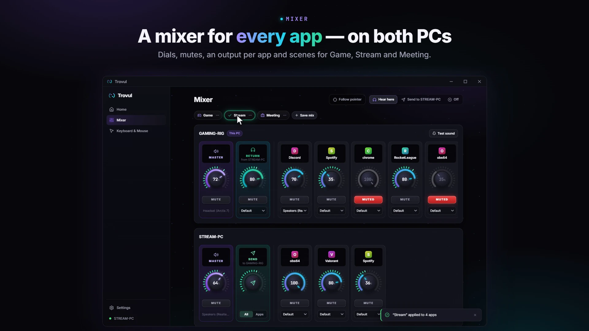
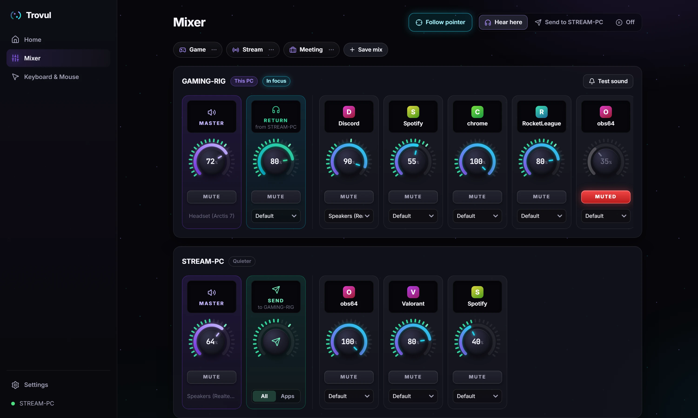
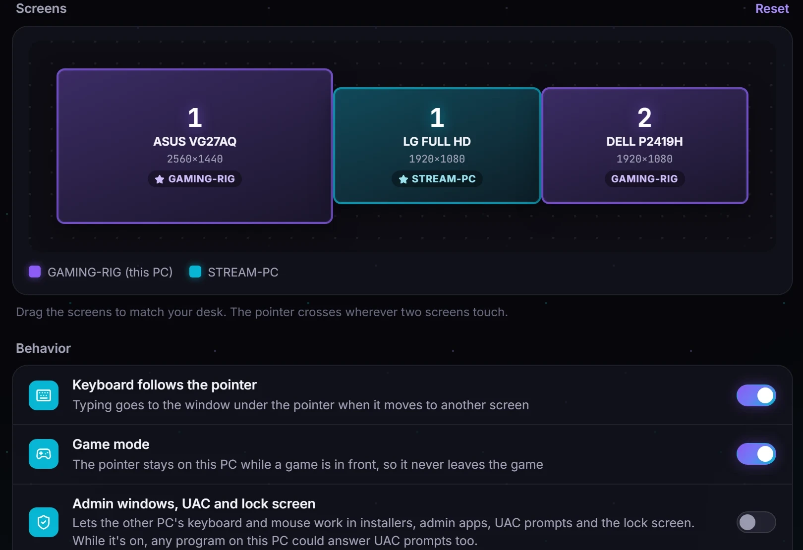
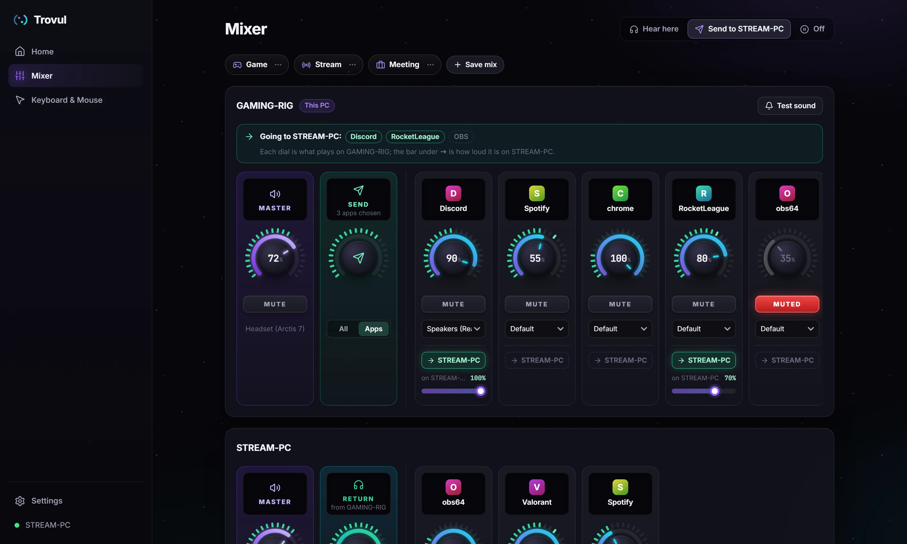
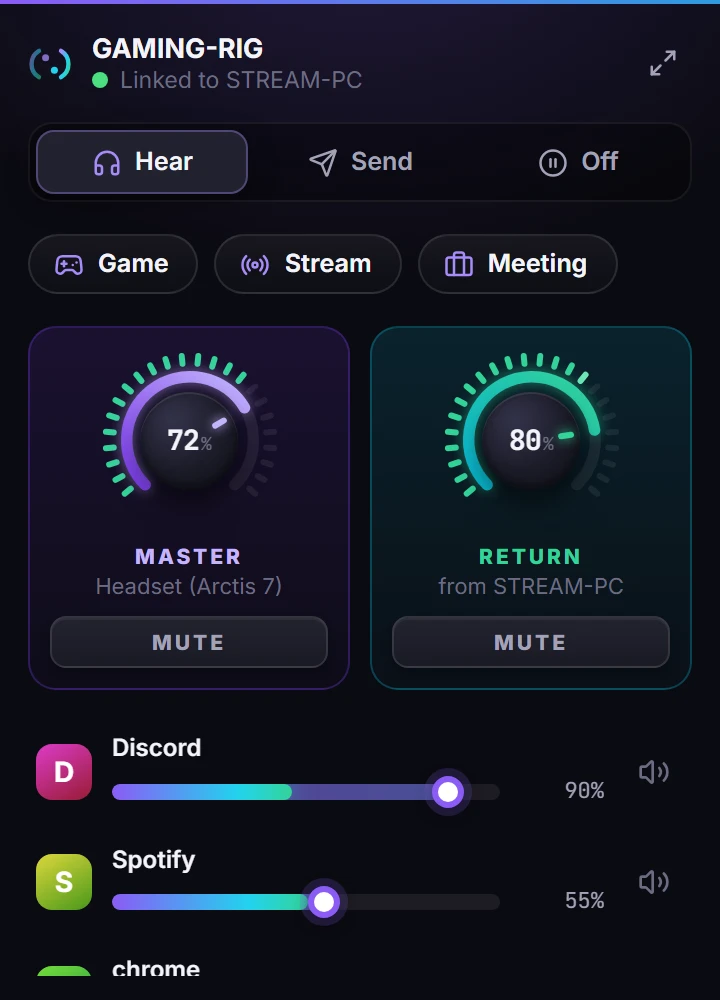
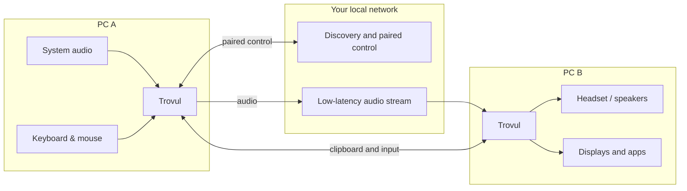

<p align="center">
  
</p>

<h1 align="center">Trovul</h1>

<p align="center">
  <strong>Two PCs. One desk.</strong><br>
  Hear both machines in one headset, mix every app, and use one keyboard and mouse across every screen.
</p>

<p align="center">
  <a href="https://github.com/leoisrael/Trovul/releases/latest">Download for Windows</a> ·
  <a href="https://trovul.com/#film">Watch the film</a> ·
  <a href="https://trovul.com">Website</a> ·
  <a href="#build-from-source">Build from source</a> ·
  <a href="CONTRIBUTING.md">Contribute</a>
</p>

<p align="center">
  <a href="LICENSE"></a>
  
  
  
  
</p>

<p align="center">
  <a href="https://github.com/leoisrael/Trovul/stargazers"></a>
  <a href="https://github.com/leoisrael/Trovul/issues"></a>
  <a href="https://github.com/leoisrael/Trovul/releases"></a>
</p>

> **Source-available, not Open Source.** Trovul welcomes contributions and
> permitted forks, but its code may not be used to provide a competing product.
> Read the [license](LICENSE), [brand policy](TRADEMARKS.md), and
> [contributor agreement](CONTRIBUTOR-LICENSE-AGREEMENT.md) before using or
> contributing to the project.

<p align="center">
  <a href="https://trovul.com/#film"></a><br>
  <a href="https://trovul.com/#film"><strong>▶ Watch Trovul in action</strong></a>
</p>

<p align="center"><sub>Free to use · Experimental and in active development · Windows 10 &amp; 11</sub></p>

---

## The dual-PC setup, without the pile of hardware

Gaming PC plus streaming PC. Work laptop plus desktop. Two machines are useful,
but the desk usually ends up with a second headset, an audio interface, a USB
switch, cables, and three different utilities that barely know about each
other.

Trovul turns the two PCs into one workspace over your local network. Pair once,
then decide where sound goes, control every app, and move naturally between
screens.

<p align="center">
  
</p>

## What you get

| Hear | Mix | Control |
|---|---|---|
| Send either PC's system audio to the other with one click. | Mix master, return audio, and individual apps on both machines. | Move the pointer across your real desk layout; the keyboard follows. |
| Low, Balanced, and Stable latency modes with an adaptive jitter buffer. | Route an app to a specific output device and save complete scenes. | Share clipboard text, screenshots, and files between paired PCs. |
| Works with USB, Bluetooth, analog, stereo, and surround devices. | Use tray controls, global shortcuts, Stream Deck, and an opt-in Companion API. | Keep working through reconnects, sleep, device changes, and Wi-Fi drops. |

### Built for the moments that make two PCs worth having

- **Streamers:** game on one PC, capture on another, and hear the whole setup in one headset.
- **Gamers:** stop swapping headsets or cables just to use a second machine.
- **Creators:** keep Discord, editing, music, and capture exactly where they belong.
- **Power users:** make a laptop and a desktop feel like one desk, not two isolated islands.

## See the workspace

| Mixer | Keyboard & mouse |
|---|---|
|  |  |

| Stream mix | Tray mixer |
|---|---|
|  |  |

<sub>Product visuals show an illustrative setup.</sub>

## How it works



1. Both PCs find each other on the same local network.
2. You approve the pairing once.
3. Trovul keeps a control link alive and moves the audio, input, clipboard, and
   mixer state you choose to share.

The detailed technical map lives in [docs/ARCHITECTURE.md](docs/ARCHITECTURE.md).

## Feature set

<details>
<summary><strong>Audio and mixer</strong></summary>

- One-click **Hear here**, **Send there**, and **Off** direction controls.
- Real-time system audio streaming from stereo to 7.1.
- Per-app volume, mute, peaks, app icons, and output-device routing.
- Mixer scenes for game, stream, meeting, or any other setup.
- Voice-chat ducking, focus-following mix, test sound, and live diagnostics.
- Automatic device recovery and selectable Low / Balanced / Stable latency.
</details>

<details>
<summary><strong>One desk experience</strong></summary>

- Keyboard and mouse sharing with a drawn multi-monitor arrangement.
- Shared text, image, and file clipboard.
- Global hotkeys and a fast tray mixer.
- Stream Deck actions for scenes, direction, mute, focus mix, and volume.
</details>

<details>
<summary><strong>Built to stay out of the way</strong></summary>

- Local discovery, explicit pairing, and reconnect after sleep or network loss.
- Private- and domain-network firewall rules installed with the Windows MSI.
- Start with Windows, connection diagnostics, and an activity log.
- Opt-in, token-protected Companion API for local controllers.
</details>

## Get started

### Use a build

Get the latest experimental Windows installer from the
[Releases page](https://github.com/leoisrael/Trovul/releases/latest). Install the same
build on both Windows PCs, keep them on the same trusted local network, and
approve the pairing from either machine. The current installer is unsigned, so
Windows SmartScreen may show a warning. Read the release notes for its provenance.

### Build from source

Trovul currently targets **Windows 10/11**. You will need:

- [Node.js](https://nodejs.org/) 20.19 or newer;
- current stable [Rust](https://www.rust-lang.org/tools/install);
- [Tauri v2 prerequisites](https://v2.tauri.app/start/prerequisites/).

```powershell
git clone https://github.com/leoisrael/Trovul.git
cd Trovul
npm ci
npm run tauri dev
```

To build an installer:

```powershell
npm run tauri build
```

For UI work without a second PC, run `npm run dev` and open the built-in preview
with a state such as:

```text
http://localhost:1420/dev/preview.html?state=receiving#/home
```

See [docs/DEVELOPMENT.md](docs/DEVELOPMENT.md) for commands, preview states,
and test expectations.

## Project status

Trovul is usable today on trusted Windows LANs. The big next steps are drag and
drop between PCs, a phone mixer, screen sharing, cross-platform support, and
end-to-end encryption. Follow the [roadmap](docs/ROADMAP.md) for the current
direction.

## Security and privacy

Trovul is designed for PCs you control on a trusted local network. Do not expose
its network services directly to the internet. Please read [SECURITY.md](SECURITY.md)
before reporting a vulnerability or using sensitive features on a shared network.

## Help build it

Great first contributions include reproducible bug reports, device-compatibility
testing, Windows accessibility improvements, documentation, and focused fixes.

- [Contribution guide](CONTRIBUTING.md)
- [Support guide](SUPPORT.md)
- [Security policy](SECURITY.md)
- [Release smoke test](docs/QA-CHECKLIST.md)
- [Open an issue](https://github.com/leoisrael/Trovul/issues)

## License, brand, and assets

The code is available under the **PolyForm Shield License 1.0.0**. You may use,
study, modify, and share it under that license, but may not use it to provide a
competing product. The Trovul name, logo, product imagery, and visual identity
are not granted by the code license.

- [License](LICENSE)
- [Trademark and brand policy](TRADEMARKS.md)
- [Brand and media assets](ASSETS-LICENSE.md)
- [Contributor License Agreement](CONTRIBUTOR-LICENSE-AGREEMENT.md)

<p align="center">
  <strong>One desk. Two PCs. No extra hardware.</strong><br>
  Built with Rust, Tauri, React, and a stubborn dislike of cable clutter.
</p>

