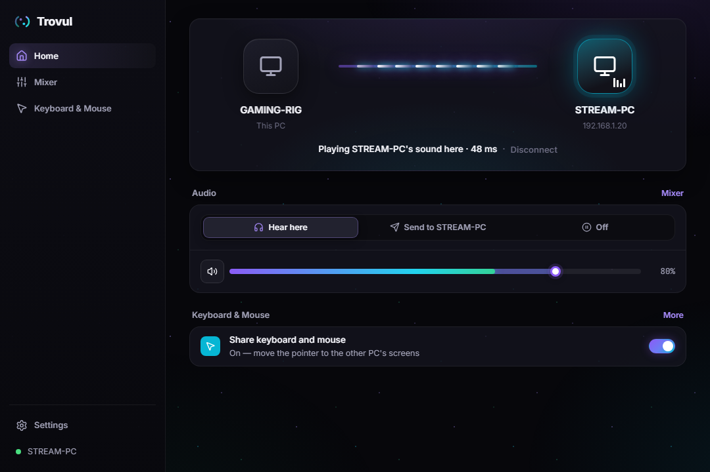
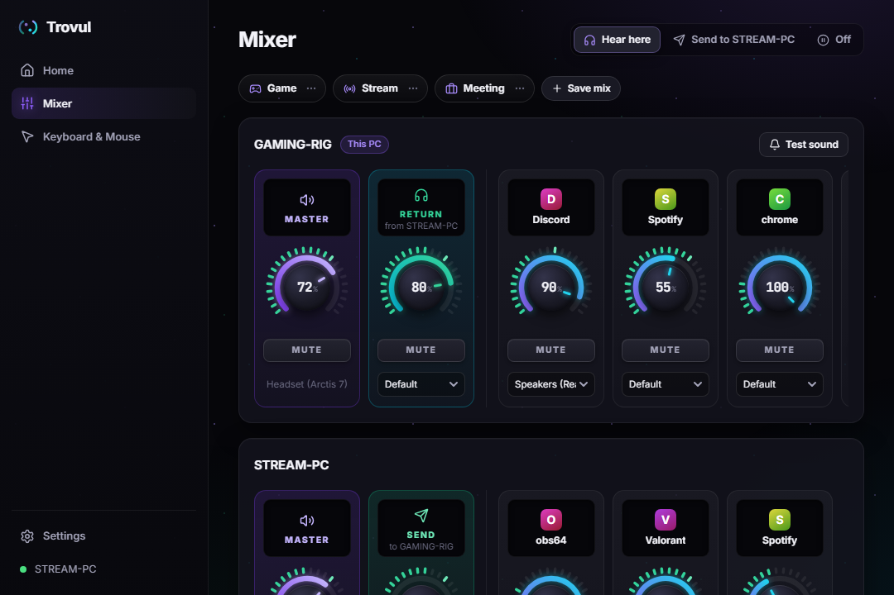
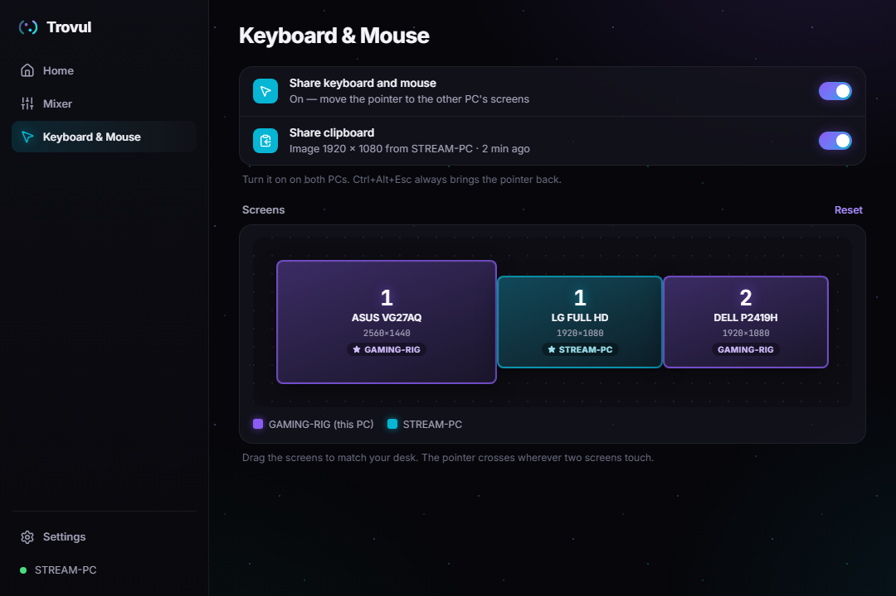
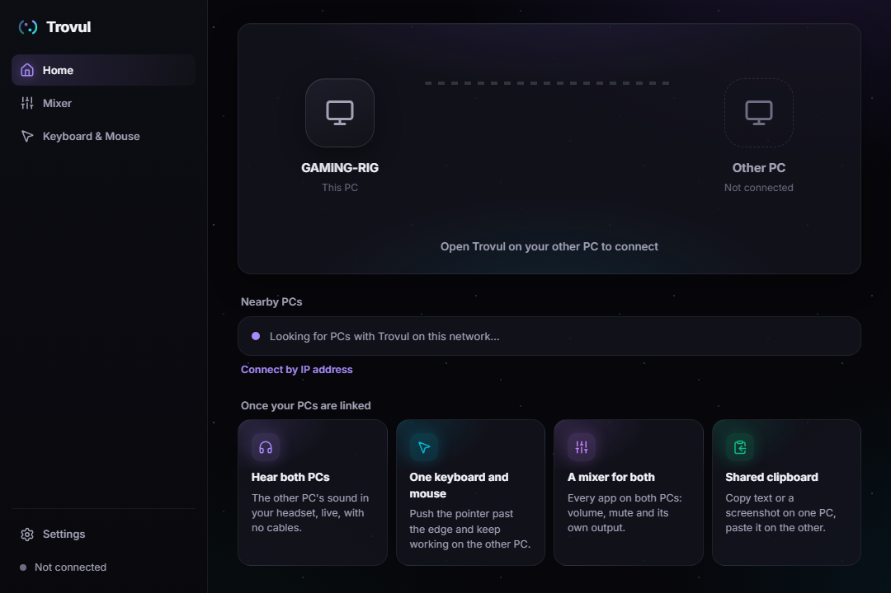
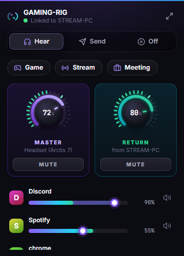
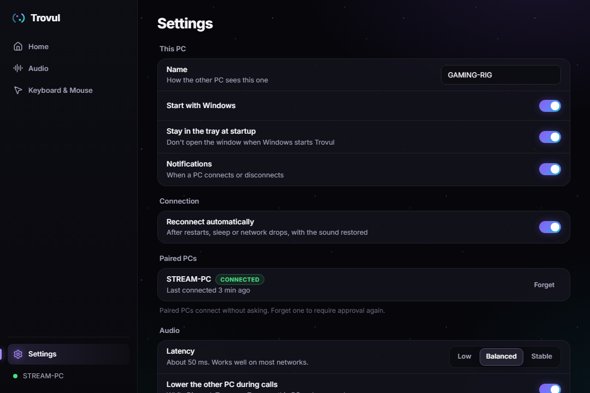
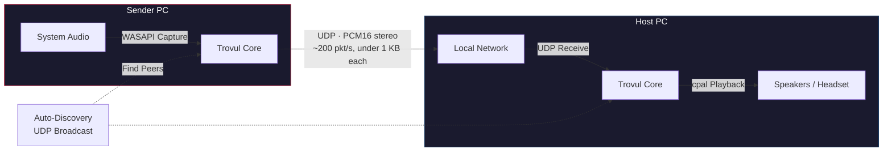

<p align="center">
  <h1 align="center">🔊 Trovul</h1>
  <p align="center"><strong>One desk, two PCs.</strong></p>
  <p align="center"><em>Real-time audio streaming between PCs. Zero cables. Zero extra hardware.</em></p>
</p>

<p align="center">
  <a href="#license-and-contributions"></a>
  
  
  
  
</p>

<p align="center">
  <a href="https://github.com/leoisrael/Trovul/stargazers"></a>
  <a href="https://github.com/leoisrael/Trovul/network/members"></a>
  <a href="https://github.com/leoisrael/Trovul/issues"></a>
</p>

---

> **Source-available, not Open Source.** Trovul welcomes fixes and
> contributions, but its code may not be used to provide a competing product.
> See [LICENSE](LICENSE), [TRADEMARKS.md](TRADEMARKS.md), and
> [CONTRIBUTOR-LICENSE-AGREEMENT.md](CONTRIBUTOR-LICENSE-AGREEMENT.md) before
> using or contributing to the project.

> **Replace your $500 audio mixer with a single install.**  
> Stream system audio between PCs over your local network with low, self-tuning latency. No cables, no extra hardware, no complex setup.

---



## ✨ Features

| | Feature | Description |
|---|---|---|
| 🎧 | **One-Click Direction** | "Hear the other PC here" or "send this PC's audio" — one click configures both PCs |
| 🔄 | **Set and Forget** | Pair once; Trovul starts with Windows, reconnects after reboots, sleep or Wi-Fi drops, and brings the audio back |
| 🔊 | **Audio Streaming** | Real-time system audio between PCs on the LAN, any speaker layout (stereo … 7.1) |
| 🔍 | **Auto-Discovery** | PCs find each other automatically — or connect by IP address. Give each PC a friendly name |
| 🛡️ | **Works Out of the Box** | The installer sets up Windows Firewall, and Trovul tells you when Windows marks your network as Public |
| 🎚️ | **Mixer** | Laid out like an audio interface: dials with LED level rings and mute for the master, the other PC's return and every app — on both PCs |
| 🎬 | **Scenes** | Save a mix of both PCs ("Game", "Stream", "Meeting") and switch to it in one click — even from the tray |
| 🎛️ | **Stream Deck** | Keys for scenes, direction, mute and follow-the-pointer; volume dials on Stream Deck + — for both PCs |
| 🔀 | **Output per App** | Send each app to its own device (Discord to the headset, the game to the speakers), on either PC |
| 🖱️ | **Keyboard & Mouse Sharing** | One mouse and keyboard for both PCs — draw your real desk (even the other PC's screen *between* two of yours) and the pointer follows it |
| 📋 | **Shared Clipboard** | Copy text or a screenshot on one PC, paste it on the other — content password-manager apps mark as private stays put |
| ⬆️ | **Updates Over the Link** | Update one PC and the other is invited to take the same version from it — signed with the pairing, no download |
| 🗣️ | **Voice-Chat Ducking** | The other PC's audio lowers by itself while someone talks on Discord, Teams or Zoom, then fades back |
| ⌨️ | **Global Shortcuts** | Ctrl+Alt+M mutes the other PC, Ctrl+Alt+T turns audio on/off — even inside games |
| 🟢 | **Tray Mixer** | Click the tray icon for a pop-up mixer: direction, master and the other PC as dials, every app with its level — plus a status dot on the icon |
| 🔔 | **Test Sound** | Sends a chime through the whole pipeline to confirm the setup in a second |
| ⏱️ | **Latency Modes** | Low / Balanced / Stable, with an adaptive jitter buffer inside each mode |
| 📊 | **Live Diagnostics** | Connection quality, delay, packet loss, clock drift and bitrate |
| 🔒 | **Paired Connections** | Only a PC you approved can control this PC or stream audio to it |
| 🎧 | **Universal Devices** | Bluetooth, USB, analog — pick the output for the other PC's audio |
| 📱 | **Companion API** | Opt-in, token-protected WebSocket API for external controllers |

| Mixer | Home |
|---|---|
|  |  |
| **Keyboard & Mouse** | **Connect a PC** |
|  |  |
| **Tray mixer** | **Settings** |
|  |  |

## 🚀 Quick Start

### Prerequisites

- [Node.js](https://nodejs.org/) 20.19+ (required by Vite 7)
- [Rust](https://www.rust-lang.org/tools/install) (latest stable)
- [Tauri v2 prerequisites](https://v2.tauri.app/start/prerequisites/)

### Build & Run

```bash
# Clone the repository
git clone https://github.com/leoisrael/Trovul.git
cd Trovul

# Install dependencies
npm install

# Run in development mode
npm run tauri dev

# Build for production
npm run tauri build
```

**Designing the UI without two PCs:** `npm run dev`, then open `http://localhost:1420/dev/preview.html?state=receiving#/home` (states: `firstrun`, `disconnected`, `public`, `reconnecting`, `receiving`, `sending`, `idle`; routes: `#/home`, `#/audio` (the mixer), `#/input`, `#/settings`). It runs the real UI against a fake backend (`dev/mock-tauri.ts`).

The installer will be generated in `src-tauri/target/release/bundle/`.

## 🏗️ Architecture



**Connection flow:** Peers discover each other via UDP broadcast → the user approves the pairing once → a persistent TCP control link (heartbeat, remote mixer) connects the two PCs → audio streams over UDP and is accepted only from the paired PC.

## ⚡ Performance

| Metric | Value |
|---|---|
| **Receive buffer** | Adaptive jitter buffer: starts at 50 ms, 30–250 ms depending on the network |
| **Bandwidth** | ~1.6 Mbit/s per stream (48 kHz stereo, 16-bit PCM) |
| **CPU Usage** | < 2% sender · < 3% receiver |
| **Packet Rate** | ~200 packets/sec (5 ms each, under 1 KB — no IP fragmentation) |
| **Bundle Size** | ~5 MB installer |

## 🛠️ Tech Stack

| Layer | Technology | Why |
|---|---|---|
| **Core Engine** | Rust | Native performance, memory safety, zero-cost abstractions |
| **Audio Capture** | WASAPI | Direct hardware access on Windows, loopback capture |
| **Audio Playback** | cpal | Cross-platform audio abstraction |
| **Networking** | UDP + TCP | UDP for low-latency audio, TCP for control messages |
| **UI Framework** | React + TypeScript | Fast development, rich ecosystem |
| **Desktop Runtime** | Tauri v2 | Tiny bundles, native performance, cross-platform |

## 🗺️ Roadmap

Details and what comes next: [docs/ROADMAP.md](docs/ROADMAP.md).

- [x] Real-time audio streaming (sender ↔ host)
- [x] Auto-discovery via UDP broadcast
- [x] Universal device support (Bluetooth, USB, analog)
- [x] Real-time diagnostics panel
- [x] Per-app volume control (local + remote)
- [x] System tray with quick controls
- [x] Companion WebSocket API
- [x] Global hotkeys
- [x] One-click audio direction, pairing and automatic reconnect
- [x] Voice-chat ducking
- [x] Keyboard & mouse sharing with a drawn screen arrangement
- [x] Shared clipboard (text, images and files)
- [ ] Screen sharing and remote control
- [x] Firewall setup in the installer, Public-network warning
- [ ] Code-signed installer and auto-update
- [x] Mixer with dials, meters and an output device per app
- [x] Choose which apps to stream, with their own levels (Windows 11)
- [x] Follow the pointer (the PC you're using is louder)
- [x] Stream Deck plugin
- [ ] Drag files between the PCs
- [ ] Mixer on the phone
- [ ] Opus codec compression
- [ ] WAN support (streaming over the internet)
- [ ] macOS and Linux support
- [ ] End-to-end encryption

## 🎯 Use Cases

| Audience | Problem Solved |
|---|---|
| **Gamers** | Dual-PC streaming setup without $500+ in audio hardware and cables |
| **Streamers** | Professional audio routing — game on PC1, OBS on PC2, audio flows seamlessly |
| **Podcasters** | Multiple hosts, multiple machines, one unified audio stream |
| **Corporate** | Call centers, trading floors — unified audio across workstations |
| **Education** | Teacher demos heard by all students in real-time |
| **Tech Support** | Hear exactly what the client hears to diagnose audio issues |

## 🤝 Contributing

We welcome contributions that improve Trovul for its users. Please read
[CONTRIBUTING.md](CONTRIBUTING.md) and accept the
[Contributor License Agreement](CONTRIBUTOR-LICENSE-AGREEMENT.md) before
opening a pull request.

**Quick overview:**

1. Fork the repo
2. Create a feature branch (`git checkout -b feature/amazing-feature`)
3. Commit your changes (`git commit -m 'Add amazing feature'`)
4. Push to the branch (`git push origin feature/amazing-feature`)
5. Open a Pull Request

## 📄 License and contributions

Trovul is source-available under the **PolyForm Shield License 1.0.0**. You
may study, use, modify, and share the code subject to that license, but you may
not use it to provide a product that competes with Trovul. The name, logos, and
other brand assets are not licensed for independent use; see
[TRADEMARKS.md](TRADEMARKS.md) and [ASSETS-LICENSE.md](ASSETS-LICENSE.md).

---

<p align="center">
  <strong>Trovul</strong>
  <br>
  <em>"Because audio shouldn't need cables."</em>
  <br><br>
  <a href="https://trovul.com">Website</a> · <a href="https://github.com/leoisrael/Trovul/issues">Report Bug</a> · <a href="https://github.com/leoisrael/Trovul/issues">Request Feature</a>
</p>
